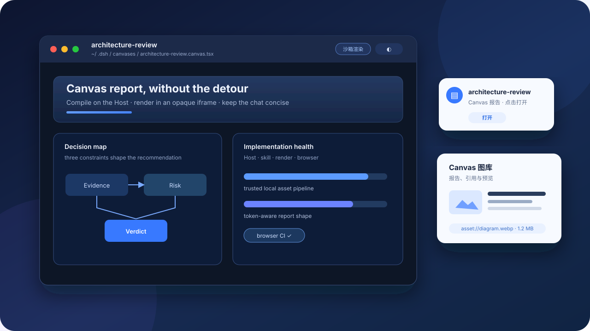
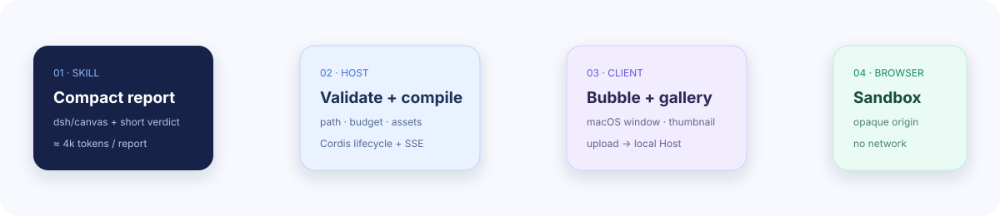

# dsh-canvas-viewer

[](https://github.com/JUANWANG-BUAA/dsh-canvas-viewer/actions) [](https://github.com/JUANWANG-BUAA/dsh-canvas-viewer/releases) [](LICENSE)

中文：[README.md](README.md)

Turn investigation, architecture, and design conclusions into real `.canvas.tsx` reports inside DeepSeek Harness: the conversation bubble discovers a report, the clean macOS-style window reads it on an undistorted pixel plane, the settings gallery manages it, and the sandbox renders it.



## The short version

- **Host + Web UI + dsh skill**: this is a native plugin, not a second Canvas editor.
- Reports stay in `~/.dsh/canvases/`; images stay in `~/.dsh/canvas-assets/`; the default workflow is local, not a remote CDN.
- The Host validates paths, budgets, and assets before compiling. The browser renders inside an opaque-origin iframe with network disabled.
- `asset://diagram.webp` keeps report source compact. The gallery lazy-loads the first referenced image; it does not execute an entire report just to make a thumbnail.
- The client remains the dsh external factory. The security-sensitive asset boundary is now strict TypeScript source with a committed JavaScript runtime artifact.
- Verified with DeepSeek Harness **0.1.1-rc.2** (npm `latest`/`next`); CI includes a real DSH profile composition smoke.

## Install in one minute

Replace `<40-character-commit-sha>` with a full commit SHA you have reviewed. Pinning a commit keeps a dsh profile reproducible.

```sh
# GitHub / community install
dsh plugin --profile web add github:JUANWANG-BUAA/dsh-canvas-viewer#<40-character-commit-sha>

# Inspect the composed profile
dsh --profile web --dump-config

# Restart after changing the plugin set; client file edits use dsh Web HMR
dsh web
```

The community phrase “`dsh add`” means the `dsh plugin --profile web add` flow above. It is not a separate command that bypasses the profile. See [client architecture](docs/CLIENT-ARCHITECTURE.md) for activation and refresh boundaries.

Local development:

```sh
git clone https://github.com/JUANWANG-BUAA/dsh-canvas-viewer.git
cd dsh-canvas-viewer
pnpm install
pnpm test
bash scripts/sync-install.sh
```

If the web profile also contains unrelated GitHub SSH dependencies, scope a transport override to this refresh only; it never rewrites global Git configuration. You may also pin the npm registry explicitly:

```sh
DSH_GIT_URL_BASE=https://github.com/ \
DSH_NPM_REGISTRY=https://registry.npmjs.org \
DSH_PNPM_NO_OPTIONAL=1 \
bash scripts/sync-install.sh
```

Use `DSH_PNPM_NO_OPTIONAL=1` only when the current platform does not need the profile's unrelated optional packages. The script always mutates the profile through `dsh plugin --profile web add`; it never overwrites `node_modules` directly. dsh may re-resolve unrelated profile plugins during refresh, so fix network/cache access and retry if one of those external dependencies is unreachable.

## From skill to pixels



| Stage | What happens | Boundary |
| --- | --- | --- |
| Skill | `canvas-analysis-report` writes a compact, reproducible report | roughly 80 lines / 16KB / 4k estimated tokens |
| Host | `view_canvas` validates HOME, budgets, compiles, and materializes `asset://` | failed calls never create a chat bubble |
| Cordis | tools, prompt, routes, and reversible effects are registered | unload removes routes, watchers, SSE, and UI |
| Client | the external factory injects the bubble, window, and gallery | it is not bundled into the prebuilt shell |
| Browser | iframe sandbox + CSP + Preact compat render the report | `connect-src 'none'`, no network by default |

## What you get

- **Conversation bubble**: only a successful `view_canvas` call appears; clicking it opens the report.
- **Viewer window**: clean translucent macOS chrome over an opaque pixel plane, multiple tabs, 70%–140% zoom, source/render split, atomic save, hot reload, copy/download, live host-synchronized appearance, Esc close, and mobile full-screen mode.
- **Gallery**: all/recent views, search, workspace filtering, path/Markdown/@ references, real-pixel `asset://` thumbnails, and browser-side WebP upload.
- **Canvas SDK subset**: Stack, Grid, Table, DAG, Stats, Bar/Line/Pie, Callout, CollapsibleSection, and more; unsupported props show a degraded badge.
- **Diagnostics**: lines, bytes, estimated tokens, inline-data/repetition warnings, soft/hard budgets, and source-mapped compile errors.

## Local assets, intentionally not a CDN

Images are treated as controlled local dsh data rather than public static content:

```tsx
export default function Report() {
  return ;
}
```

- The browser scales uploads to a 1600px longest edge and compresses them to WebP. The Host accepts a single filename and a 2MB maximum.
- The Host validates PNG/JPEG/GIF/WebP/AVIF signatures, rejecting extension-only disguises.
- `GET /api/canvas/assets/raw` returns an `ETag`; repeated gallery opens can revalidate instead of downloading unchanged pixels. Responses include `nosniff`, same-origin isolation, and private caching.
- Raw assets never grant the iframe network access; controlled images are inlined at compile time.
- A remote CDN is deliberately not the default: it adds credentials, lifecycle, CORS, and privacy surfaces and weakens offline reproducibility. Team sharing should be an explicit Host provider with permissions and a remote asset protocol, not arbitrary URLs in reports.

## Token strategy

The system prompt stays short. Evidence lives in Canvas; chat returns a two-to-four sentence verdict. Tune the recommended policy in `~/.dsh/canvas-viewer/settings.json`:

```json
{
  "budget": {
    "maxLines": 120,
    "maxBytes": 24000,
    "maxTokens": 6000,
    "enforce": "soft"
  }
}
```

`soft` annotates; `hard` rejects an over-budget `view_canvas`. Token counts are stable heuristic diagnostics, not billing tokenizer output. Use `asset://` instead of embedding base64 in report source.

## Trust model

Canvas files are executable TSX. The default iframe isolates DOM, network, and the host origin, but it is not a promise that untrusted code becomes safe: open only `.canvas.tsx` files you trust. The compatibility renderer requires an explicit user action and may use `new Function`; keep the default sandbox path when compatibility is not needed.

## Engineering and verification

```sh
pnpm typecheck       # strict checks for src/host/*.mts
pnpm build:host      # generate committed lib/host/*.mjs runtime artifacts
pnpm test             # skill mirrors, types, Host, client, lifecycle, render, sandbox
pnpm test:browser    # Playwright: bubble + real gallery thumbnail/upload + iframe
pnpm audit --prod
npm pack --dry-run
```

The TypeScript migration is intentionally incremental: the security-sensitive asset boundary moved first, while `lib/host/assets.mjs` remains a directly loadable artifact for dsh Git installs. Future Host modules can follow the same source-to-artifact path without requiring install-time builds.

Repository map:

```text
lib/index.js                   Host plugin, view_canvas, routes, and prompt
lib/client.js                  dsh external factory: viewer, bubble, gallery
src/host/assets.mts            typed asset policy (emits lib/host/assets.mjs)
skills/canvas-analysis-report/ dsh-native skill and SDK contract
scripts/                       type, lifecycle, browser, render, and package checks
docs/                          sandbox, client architecture, assets, and workflow docs
```

## Known boundaries

- Report-level pixel thumbnails remain deferred; the gallery shows only the first source `asset://` image.
- Local Host assets are not a CDN; there is no remote team gallery, upload service, or permission sync.
- `lib/client.js` must remain a single factory entrypoint; UI source extraction must preserve the dsh loading contract.
- Profile bundle add/remove requires a Web restart; client content changes are served through the Host stat-poll/SSE HMR path.

More detail: [sandbox model](docs/SANDBOX.md) · [client architecture](docs/CLIENT-ARCHITECTURE.md) · [trade-offs](docs/COMPARISON.md) · [changelog](CHANGELOG.md)

## License

MIT
