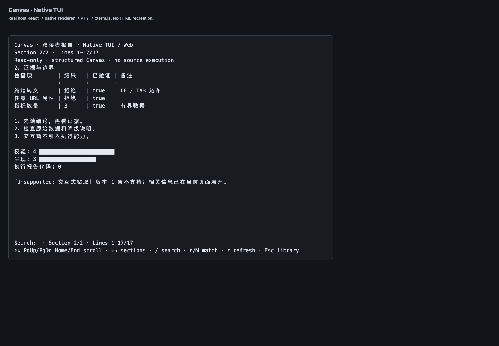
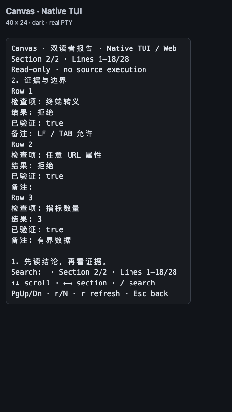

# dsh-canvas-viewer

[](https://github.com/JUANWANG-BUAA/dsh-canvas-viewer/actions) [](https://github.com/JUANWANG-BUAA/dsh-canvas-viewer/releases) [](LICENSE)

[English](README.en.md) · [文档索引](docs/README.md) · [变更记录](CHANGELOG.md)

把调查、架构评审和设计结论变成 DeepSeek Harness 中可打开的报告：**原生 TUI 只读阅读 + Web 报告工作台**，共用本地源文件。不是聊天图片协议，也不是完整的 Cursor Canvas 运行时。


## 0.6.0 概览

从 0.4.15 升级，主要新增：

- **双端数据报告**：带版本的 `.canvas.json`，包含章节、文本、提示、指标、表格、列表和条形图；两端都不执行报告提供的代码。
- **原生终端阅读器**：`/canvas` 图库、章节切换、跨章节查找、宽窄表格、滚动与刷新；TSX 显式提示改用 Web，不尝试执行或自动转换。
- **Web 工作台**：目录/正文查找、页面会话内阅读位置恢复、完整源码搜索与工作区分页；修订冲突保护、浏览器草稿及可见内容打印/PDF。
- **工程契约**：共享有界文件仓储与严格 schema；客户端源码分片构建为同一个外部 factory，Git 安装直接加载已提交产物。

| 格式 / 能力 | 原生 TUI | Web |
| --- | --- | --- |
| `.canvas.json`（`schemaVersion: 1`） | 校验后用宿主终端组件渲染，只读 | 校验后生成固定 SDK 模板，在 iframe 阅读；源码面板仍编辑 JSON |
| `.canvas.tsx` | 只显示 legacy / 未执行提示 | 编译并执行可信报告；支持 SDK 子集与受控本地图片 |
| 编辑、草稿、打印 | 不支持 | 源码编辑、冲突复核、草稿、可见内容打印预览 |
| HTML / SVG / 图片 / hooks | 不执行、不展示任意富内容 | TSX 按 SDK 与沙箱契约支持；不是任意浏览器环境 |

JSON 拒绝未知版本、键、块类型和控制序列，文本中的 HTML、URL、`asset://` 只是文字；不会解释链接或加载图片。[数据契约](skills/canvas-analysis-report/report-data.md) · [schema 源码](src/report/schema.mts) · [完整示例](fixtures/dual-reader.canvas.json)

### 原生终端实拍

| 宽屏 100×28 | 窄屏 40×24 |
| --- | --- |
|  |  |

截图来自实际宿主 renderer → 真 PTY → xterm.js 6 → Edge，不是用 HTML 重写的终端；也不代表完整 CLI/profile 启动已验收。[按键与验证边界](docs/TUI.md)

## 安装与激活

需要已安装的 DSH、相应 Web/TUI profile；包声明 Node.js ≥20，CI 使用 Node.js 22/24。通过 **Git bundle** 安装，不依赖同名 npm 包发布。

把占位符替换为审阅过的完整 40 位 commit SHA：

```sh
dsh plugin --profile web add "github:JUANWANG-BUAA/dsh-canvas-viewer#<40-character-commit-sha>"
dsh --profile web --dump-config
dsh web
```

发布标签可用于便捷安装，例如 `github:JUANWANG-BUAA/dsh-canvas-viewer#v0.6.0`；可复现部署仍应固定该标签解析出的完整 commit。安装/移除 bundle 后重启目标 profile。Web 使用 `dsh web` 输出的一次性启动链接建立 Cookie；不要记录、分享或复用其中 token。

### 原生 TUI

```sh
dsh plugin --profile dsh-tui add "github:JUANWANG-BUAA/dsh-canvas-viewer#<40-character-commit-sha>"
# 重启目标 TUI profile 后，在输入框使用：
# /canvas
# /canvas ~/.dsh/canvases/report.canvas.json
```

`dsh-tui` 是目标 profile 名示例，按实际配置替换。`dsh-canvas-viewer/tui` 是同包子入口，**不是独立 npm 包**：

- `cordis.patch.yml` 同时声明 Web 根入口与 `./tui` 行，各自按服务依赖激活。
- 纯 TUI 的 `./tui` 只硬依赖 `commands`、`tuiScenes`，不要求 Web server、编译器或浏览器；React/UI 由宿主注入。
- 宿主 Loader 须读取 `dsh-plugin.json` 完成准入，再由 `tuiPluginHost.registerCommand` 归属到 `canvas.viewer.open`。manifest 声明命令、Scene 与命令 scope 权限；不手动调用准入私有接口、不绕过 deny。Scene 是进程内插件，**不是安全沙箱**。

推荐冷启动；晚启动 admission-loader 的热补准入、权限实时撤销与未来 TUI 版本不作兼容保证。[TUI 安装契约](docs/TUI.md)

### 安装写作 skill（可选）

插件与文件系统 skill 是两层：安装 bundle 不等于安装 skill。将仓库 `skills/canvas-analysis-report/` 复制到 `~/.dsh/skills/canvas-analysis-report/`，再按宿主方式刷新 skill。

本地开发可用 `dsh plugin --profile web add ./`（保留 checkout）；`bash scripts/sync-install.sh` 则复制插件与 skill 到 `~/.dsh/`，并通过 DSH 命令刷新 **web profile**，不是 TUI 安装器。脚本支持进程级 `DSH_GIT_URL_BASE` / `DSH_NPM_REGISTRY` 覆盖，不修改全局 Git 配置；其它 profile 依赖不可达时应先修复网络/缓存，不直接覆盖 `node_modules`。

## 三个入口，不要混用

| 入口 | 作用 | 不承诺什么 |
| --- | --- | --- |
| TUI `/canvas [path]` | 打开图库或已有数据报告；无路径时扫描 `~/.dsh/canvases/` | 不写报告、不发会话消息、不注册第二个 `view_canvas` |
| `canvas-analysis-report` skill（宿主可显示为 `/canvas-analysis-report`） | 指导 Agent 取证、写报告；双端优先 JSON，Web 丰富交互用 TSX | 不是阅读器命令；skill 的斜杠呈现由宿主决定 |
| Web `view_canvas({path})` | Agent 写文件后调用；校验成功的结果形成聊天尾卡，点击打开工作台 | 不是聊天图片/截图附件协议，不返回报告像素图 |

聊天图片仍走当前宿主实际提供的图像工具或附件协议；不要把 Markdown 图片、截图附件和 Canvas 报告卡混为一谈。纯 TUI 只调用实际存在的工具，不要求不存在的 `view_canvas`。

建议流程：取证 → 写 `~/.dsh/canvases/<name>.canvas.json` → 用户 `/canvas` 阅读；Web 可用同一 JSON 或可信 TSX，再调用 `view_canvas`。聊天保留 2–4 句结论，详细证据留在报告。[写作 skill](skills/canvas-analysis-report/SKILL.md) · [Web SDK 子集](skills/canvas-analysis-report/sdk.md)

## Web 工作台与安全编辑

- **阅读**：多标签浮窗、70%–140% 缩放、实时宿主主题、手机全屏；iframe 内目录/正文查找，最多 50 个路径的阅读位置仅保留在当前页面内存。切换源码面板不重载正文。
- **查找**：图库按完整源码文字、标题、路径与工作区做字面搜索，先过滤再分页，显示总数并防止旧请求覆盖新结果；不是语义搜索或持久索引。
- **保存**：Host 是源文件权威，UI 带原始字节修订号保存；冲突返回 409，保留本地草稿并要求复核。插件写入串行化并原子 rename，但不能保证与外部编辑器之间的文件系统 CAS；没有自动合并、历史时间线或多人协作。
- **草稿**：关闭未保存报告可继续、保留或放弃；保存中仍可输入且不会被旧响应覆盖。草稿只在当前浏览器/来源 localStorage，最多 10 份、总计 1 MiB、7 天过期；不是服务器备份或跨设备同步。共享浏览器不宜留敏感源码；卸载不会清理草稿，需放弃草稿或清除站点数据。
- **打印/PDF**：先生成经白名单重建、无脚本的当前可见内容预览，再由用户打印/另存 PDF。隐藏标签、折叠内容不包含；不是整份交互报告快照或像素保真导出。

[工作台保存、草稿与打印契约](docs/WORKSPACE.md)

## 本地数据与信任边界

| 数据 | 默认位置 / 策略 |
| --- | --- |
| 报告源码 | `~/.dsh/canvases/`；直接读取仅限 HOME 内，Web 保存/删除仅限受管报告根 |
| TSX 图片资产 | `~/.dsh/canvas-assets/`；用 ``，不把 base64 塞进源码 |
| 预算设置 | `~/.dsh/canvas-viewer/settings.json` 的 `budget`；`soft` 标记、`hard` 拒绝超限 `view_canvas` |

- **JSON 是数据，TSX 是代码**。JSON 经过严格 schema 和固定模板；TSX 只打开可信来源。默认 opaque-origin iframe + CSP 禁网、不用 `unsafe-eval`；加载/错误不自动降级到主线程。兼容执行需逐报告修订明确批准，可能使用 `new Function`，会削弱隔离。
- Host 插件使用 DSH 进程权限，不受 Agent 工具沙箱自动保护。TUI 文件读取只读，拒绝符号链接/非普通文件；有扫描、缓存、预览与格式输出上限，遇限显示 `PARTIAL SCAN`，总数不代表完整磁盘库存。
- 图片上传在浏览器缩放至最长边 1600px 并压缩 WebP；Host 校验文件签名、单层名称与 2MB 上限。受控图片在编译阶段内联，图库仅懒加载首张引用图片，不运行报告生成缩略图。没有默认远程 CDN、团队图库或权限同步。
- 写作建议约 ≤80 行 / ≤16KB / ≈4k 源码 tokens；估算是诊断，不是计费 tokenizer。JSON 另有 1.5MB 读取硬上限及结构预算，以 [schema 契约](skills/canvas-analysis-report/report-data.md) 为准。

[沙箱](docs/SANDBOX.md) · [资产](docs/ASSETS.md) · [取舍](docs/COMPARISON.md)

## 兼容性与验证范围

| 基线 | 实际范围 |
| --- | --- |
| CI：DSH `0.2.1-rc.2` | `dsh-smoke` 固定 `dsh-v0.2.1-rc.2` / `687f282e8625c6b8d11ff58211a90524be2e4317`；真实 Web profile、token/Cookie、combo factory 与 UI smoke，当前改动结果以对应 CI 运行记录为准 |
| 本机已安装 DSH：`0.2.0-rc.2` | 既有真实 Web 组合与客户端激活验证；**不冒充 CI 的 0.2.1 基线** |
| 已安装 dsh-tui：`0.16.1` | 真实 Cordis Loader + 生产 admission-loader 冷启动准入、命令/Scene、卸载重载；实际 React 终端 renderer 与 PTY → xterm → Edge 视觉验证 |
| 浏览器视觉 | 12 个截图场景覆盖宽窄、深浅色、搜索、滚动、resize、legacy 与非法数据；Web 工作台也有真实浏览器交互，部分 Host 由 fixture 模拟 |

TUI 验证**不等于完整 `dsh-tui` CLI/profile 启动或用户 profile 安装验收**，也不覆盖所有系统终端字体。CI 基线、既有本机证据、fixture 与原生 renderer 证据各自独立。[0.6.0 验证记录](docs/VERIFICATION-0.6.0.md) · [CI 配置](.github/workflows/ci.yml)

## 开发、排错与卸载

```sh
pnpm install --frozen-lockfile
pnpm build:host       # src/**/*.mts → lib/host 与 lib/report 运行产物
pnpm build:client     # src/client/*.js.part → 单个 lib/client.js factory
pnpm test            # 包/类型/产物同步、Host、工作台、schema、TUI、沙箱和生命周期
pnpm test:browser    # 浏览器 + 模拟 Host
# 可选实际宿主检查（环境要求见 docs/TUI.md）：
pnpm test:tui-runtime
pnpm test:tui-browser
```

只改 `lib/client.js` 会被产物同步检查拒绝；源码分片共享 factory scope，不是第二个 runtime loader，也不是完整 TypeScript 迁移。Git 包含运行产物，安装不要求执行构建。

Web 客户端从认证页面的 `__DSH_BOOT__` / `__ModuleLoader__` 与不可变 `plugins/??...` combo 加载，不在预构建 shell 内。用 boot graph、`#dsh-canvas-viewer-css` 和 `[data-dsh-canvas-viewer]` 排查；内容修改走 stat-poll/SSE HMR，插件集合或 Host 变更后重启。[客户端架构](docs/CLIENT-ARCHITECTURE.md)

停用/卸载目标 profile 中的 bundle：`dsh plugin --profile web remove dsh-canvas-viewer`（TUI 替换 profile 名），然后重启。另行移除文件系统 skill；报告、资产与浏览器草稿不自动删除，清理前自行备份。

## License

[MIT](LICENSE) · [第三方声明](THIRD-PARTY-NOTICES.md)
